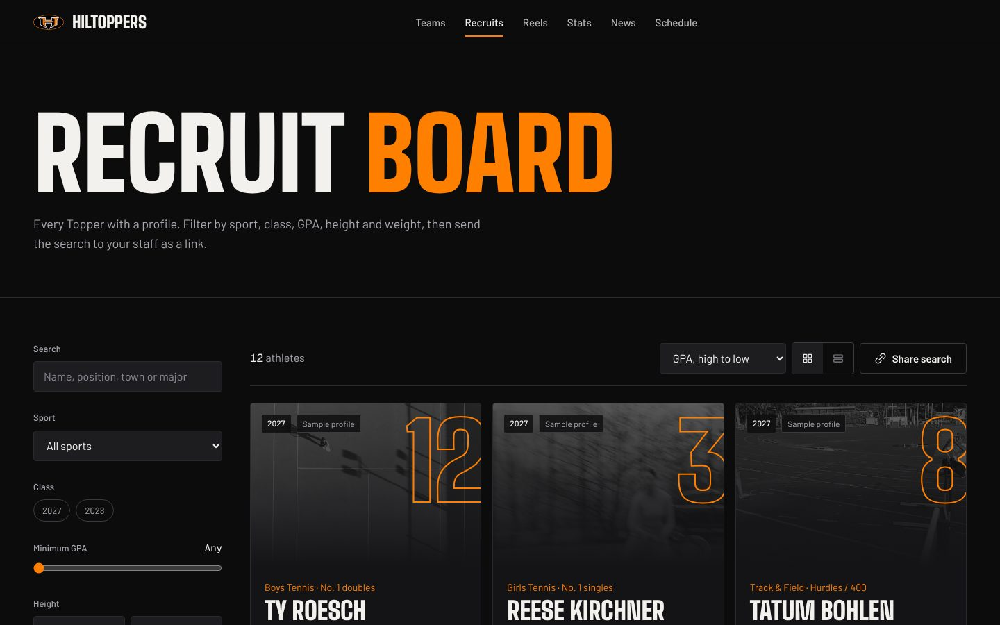
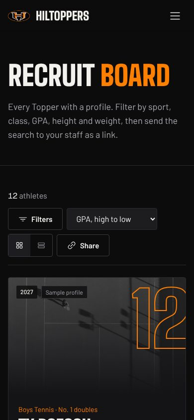
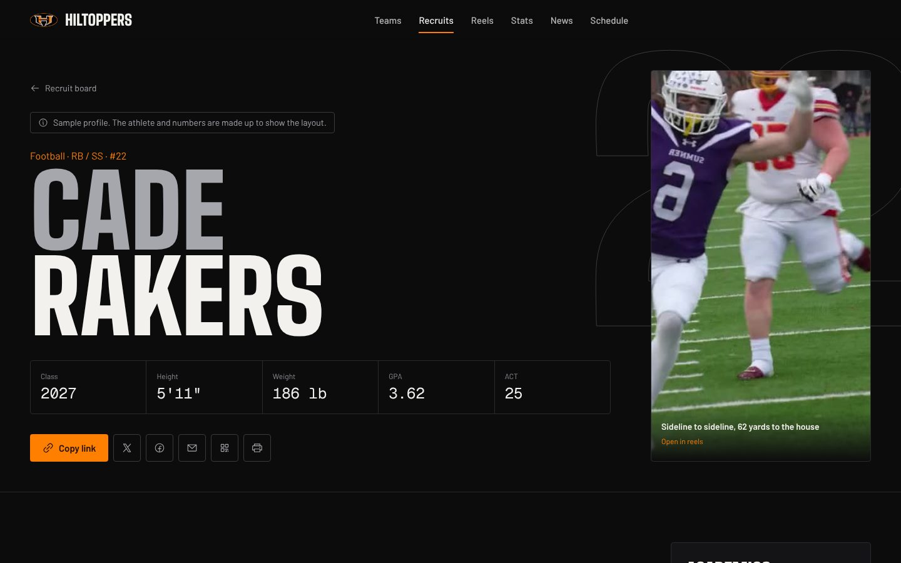
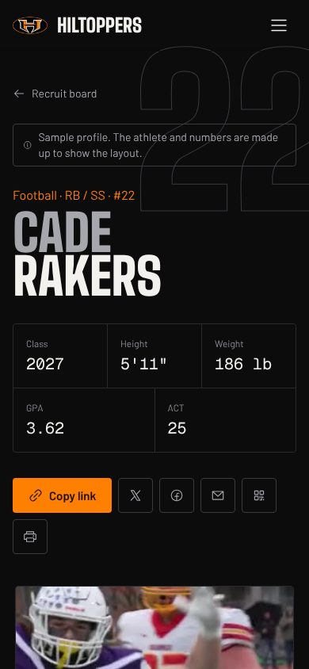
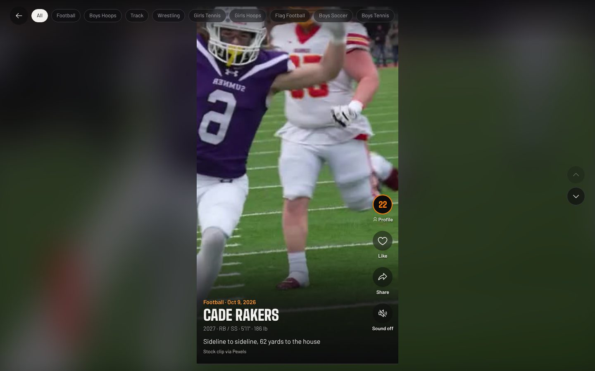

# Hillsboro Hiltoppers

The athletics site for Hillsboro High School in Hillsboro, Illinois. Black and
orange, built for three people: the college coach looking for a player, the
athlete sending their profile, and the town following the Toppers.

**What's in it**

- **Home:** full-screen hero film, results ticker, a draggable highlights rail,
  the fifteen teams by season (hover a team to preview its clip), a pinned
  sideways pan through featured athletes, and the vertical reels.
- **Recruit board** (`/athletes/`): filter by sport, class, minimum GPA, height
  and weight range, NCAA registration, or search by name, position, town or
  major. Card or table view. The search lives in the URL, so "Share search"
  sends a coach's staff the exact list.
- **Athlete profiles:** class, height, weight, GPA and test score up top;
  season-by-season stats, measurables, personal records, honors, academics,
  NCAA status, a scouting note and film. Share sheet, copy link, X, Facebook,
  email, a QR code for showcase tables, and a print layout that makes a
  one-page recruiting sheet.
- **Reels** (`/reels/`): a phone-style vertical feed. Swipe or use arrow keys,
  tap to pause, double-tap to like, share a clip, tap the jersey to open the
  athlete. Filter by sport.
- **Stats:** leaders and sortable tables for every sport with numbers on file.
- **Teams, news, schedule:** coaches as listed by the HHS athletics office,
  2026-27 schedule PDFs, and stories written from the school's own posts with a
  link back to each source.

Everything is static files. It hosts free on GitHub Pages, Vercel or Netlify.

## Run it

```bash
pnpm install
pnpm dev                 # http://localhost:3000
pnpm build               # static site in out/
```

Checks (CI runs all of them):

```bash
pnpm lint && pnpm typecheck && pnpm test && pnpm check:copy
```

## Add a real athlete

1. Get a signed media release from the family. Publish only what they approve.
   Never publish a home address, a phone number or a personal email.
2. Open `content/athletes.ts`, copy an entry, and set `sample: false`.
3. Fill it in from the transcript (unweighted GPA, ACT or SAT), the coach's
   stat book (`seasons`), and testing day (`measurables`, `records`). Stat keys
   for each sport are listed in `content/sports.ts`.
4. Add their clips (below) and list the clip ids in `reels`.
5. `pnpm check:copy` and `pnpm build`, then open the profile and print it to
   check the one-page sheet.

When the board has real athletes, delete the sample entries.

## Add a reel

Drop a vertical `.mp4` (9:16, H.264, under 10 MB, 8 to 30 seconds) and a
poster `.jpg` into `public/media/reels/`, then add a line to
`content/reels.ts`. To trim and compress a phone clip:

```bash
ffmpeg -i raw.mov -t 20 -vf "scale=720:-2" -c:v libx264 -crf 26 -an -movflags +faststart r20.mp4
ffmpeg -ss 1 -i raw.mov -frames:v 1 -vf scale=720:-2 r20.jpg
```

The template ships with stock clips from Pexels (free to use, credited on each
reel). Replace them with Topper film.

## Add news

Add an entry to `content/news.ts` with the source link. Write it like the sports
page: who, what, the score, the date. The copy check catches the rest.

## Deploy

**GitHub Pages:** push to `main`, then Settings → Pages → Source: GitHub
Actions. `.github/workflows/pages.yml` builds with the repo name as the base
path. For a custom domain, set the repo variable `BASE_PATH` to an empty value
and `SITE_URL` to the domain.

**Vercel or Netlify:** import the repo, build command `pnpm build`, output
directory `out`.

## Design and writing rules

- `DESIGN.md` the design system: tokens, type, motion, banned patterns.
- `PRODUCT.md` who the site is for and the privacy floor.
- `.claude/skills/impeccable` and `.claude/skills/design-taste-frontend`, the
  design skills every UI change goes through. `CLAUDE.md` has the steps.
- `.claude/skills/no-ai-slop` the writing rules, enforced by `pnpm check:copy`.

## Sources

School facts, coaches, schedules and news come from
[hillsboroschools.net](https://www.hillsboroschools.net),
[hhs.hillsboroschools.net/athletics](https://hhs.hillsboroschools.net/athletics)
and [hiltopperathletics.org](https://hiltopperathletics.org/) as of October
2026. The H logo belongs to Hillsboro CUSD 3. This is a fan-built site; the
district's sites are the official record.

## Screenshots

| Desktop | Phone |
| --- | --- |
|  |  |
|  |  |
|  |  |
|  |  |
