# Varsity Reach

Recruiting exposure for athletes at 1A to 4A high schools. Every school gets
its own site in its colors (Hillsboro Hiltoppers is the first real one), and
all of them feed one recruit board, one reel feed and one game-day network.

**What's in it**

- **School sites** (`/hillsboro/`, `/prairie-bend/`...): hero film, results
  ticker, highlights rail, teams by season with hover clips, featured athletes,
  reels, fundraisers, district dates. Re-skinned per school from
  `content/schools.ts`, ready to link from the district's athletics page.
- **Recruit board** (`/recruits/`): filter by sport, state, school size
  (1A to 4A), school, class, GPA, height, weight, NCAA status and
  coach-verified stats. Card or table view; the search lives in the URL.
- **Athlete profiles:** measurables, academics, season stats, records, honors,
  film, a "verified by coach" mark, share sheet, QR, a one-page print layout,
  and **Compare** against a highly rated recruit.
- **Spotlight** (`/spotlight/`): player and game spotlights by verified coaches
  and reporters, and the community-voted **Underdog of the Week**.
- **Game day** (`/games/`): an ESPN-style score bar fed by **community
  scoring**. Fans report from the stands; reports are weighted by role, track
  record, scoreboard-photo proof and freshness; a verified coach or scorer can
  lock it; fakers lose weight after every final (`lib/consensus.ts`).
- **Stream pairing:** paste a YouTube, Facebook or Twitch link and it plays
  next to the score. Instagram Live and TikTok LIVE do not allow embedding, so
  those pair as a link, and the streamer adds `/overlay/<game>/` as a browser
  source in OBS, Streamlabs or Prism to put the live score on their stream.
- **Coach dashboard** (`/coach/`): drop an Excel, CSV, Word file, PDF or a
  phone photo of the roster or stat sheet. Spreadsheets parse in the browser;
  photos and PDFs go to Claude. Every change is listed for approval before it
  publishes. Coaches also post team needs here.
- **Fundraising** (`/fundraise/`): Cash for Cleats, buses, camps, equipment.
  School and coach backing, sponsor matches, milestones that unlock, squad
  races (class vs class), backer levels, and money paid straight to the
  school's or booster club's Stripe account.
- **Gold cards** (`/gold-card/`): a season discount card on your phone with a
  signed QR code; merchants scan it at `/gold-card/verify/`.
- **Verification** (`/join/`) for coaches, athletic directors, reporters and
  official scorers.

Everything is a static site. Without a backend it runs in **demo mode**: every
flow works, writes stay in the visitor's browser, and the pages say so. Connect
Supabase (see `supabase/README.md`) and the same pages go live.

## Run it

```bash
pnpm install
pnpm dev                 # http://localhost:3000
pnpm build               # static site in out/
```

Checks (CI runs all of them, plus a Deno type-check of the functions and the
migrations applied twice to a fresh Postgres):

```bash
pnpm lint && pnpm typecheck && pnpm test && pnpm check:copy
```

Sample data: every school except Hillsboro, every athlete, game, spotlight,
fundraiser, gold card offer and reference recruit is invented and marked
`sample: true`. Sample pages carry a visible tag and a noindex. Hillsboro's
coaches, schedules and news come from the school's own sites.

## Add a real athlete

1. Get a signed media release from the family. Publish only what they approve.
   Never publish a home address, a phone number or a personal email.
2. Use the coach dashboard, or open `content/athletes.ts`, copy an entry, and set `sample: false`.
3. Fill it in from the transcript (unweighted GPA, ACT or SAT), the coach's
   stat book (`seasons`), and testing day (`measurables`, `records`). Stat keys
   for each sport are listed in `content/sports.ts`.
4. Add their clips (below) and list the clip ids in `reels`.
5. `pnpm check:copy` and `pnpm build`, then open the profile and print it to
   check the one-page sheet.

When the board has real athletes, delete the sample entries.

## Add a reel

Drop a vertical `.mp4` (9:16, H.264, under 10 MB, 8 to 30 seconds) and a
poster `.jpg` into `public/media/reels/`, then add a line to
`content/reels.ts`. To trim and compress a phone clip:

```bash
ffmpeg -i raw.mov -t 20 -vf "scale=720:-2" -c:v libx264 -crf 26 -an -movflags +faststart r20.mp4
ffmpeg -ss 1 -i raw.mov -frames:v 1 -vf scale=720:-2 r20.jpg
```

The template ships with stock clips from Pexels (free to use, credited on each
reel). Replace them with Topper film.

## Add news

Add an entry to `content/news.ts` with the source link. Write it like the sports
page: who, what, the score, the date. The copy check catches the rest.

## Deploy

**GitHub Pages:** push to `main`, then Settings → Pages → Source: GitHub
Actions. `.github/workflows/pages.yml` builds with the repo name as the base
path. For a custom domain, set the repo variable `BASE_PATH` to an empty value
and `SITE_URL` to the domain.

**Vercel or Netlify:** import the repo, build command `pnpm build`, output
directory `out`.

## Design and writing rules

- `DESIGN.md` the design system: tokens, type, motion, banned patterns.
- `PRODUCT.md` who the site is for and the privacy floor.
- `.claude/skills/impeccable` and `.claude/skills/design-taste-frontend`, the
  design skills every UI change goes through. `CLAUDE.md` has the steps.
- `.claude/skills/no-ai-slop` the writing rules, enforced by `pnpm check:copy`.

## Sources

School facts, coaches, schedules and news come from
[hillsboroschools.net](https://www.hillsboroschools.net),
[hhs.hillsboroschools.net/athletics](https://hhs.hillsboroschools.net/athletics)
and [hiltopperathletics.org](https://hiltopperathletics.org/) as of October
2026. The H logo belongs to Hillsboro CUSD 3. This is a fan-built site; the
district's sites are the official record.

## Screenshots

| Desktop | Phone |
| --- | --- |
| 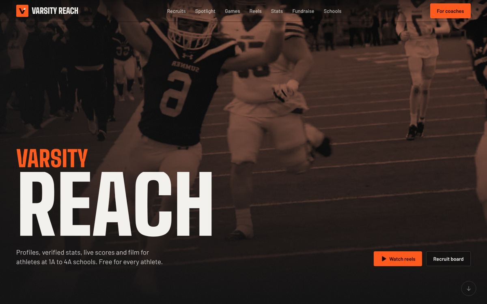 | 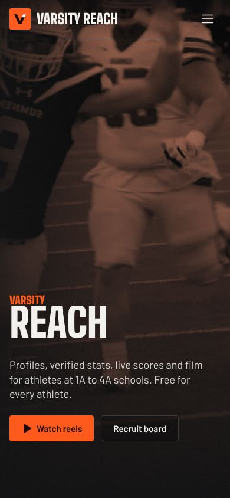 |
| 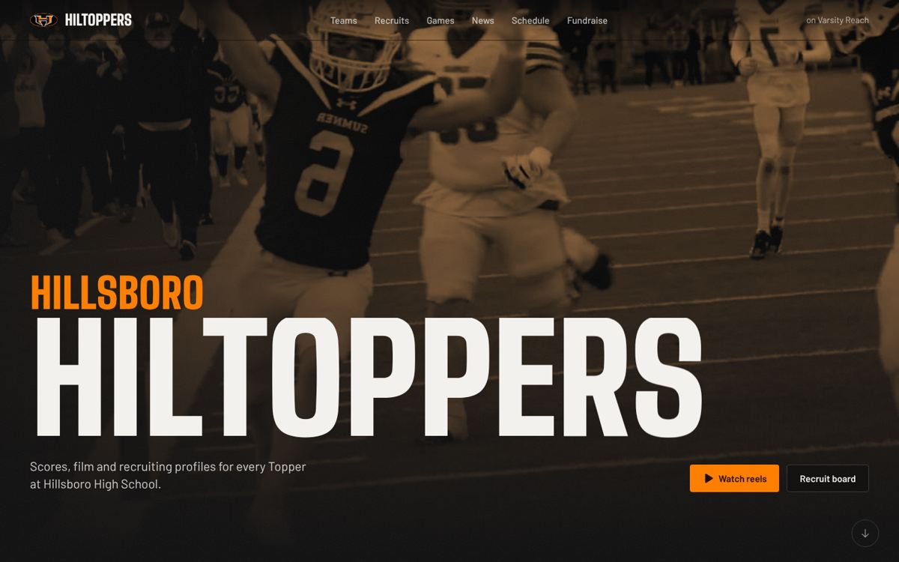 | 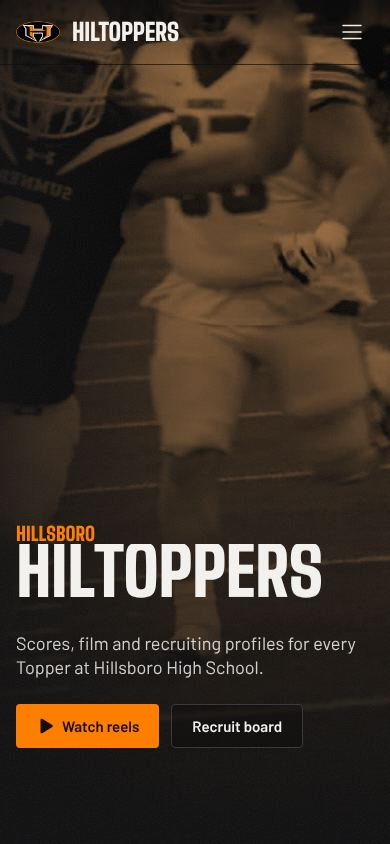 |
| 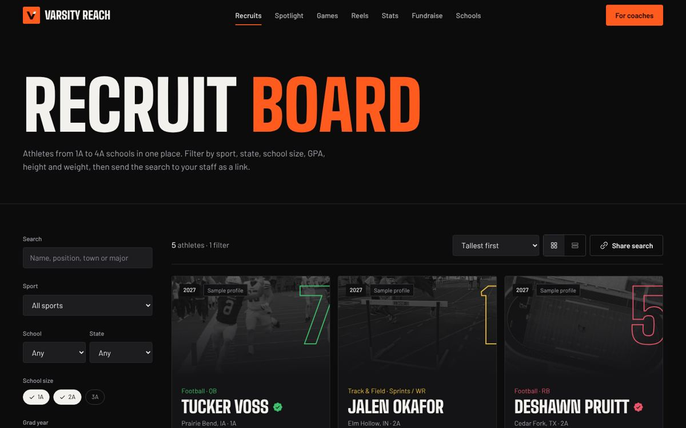 | 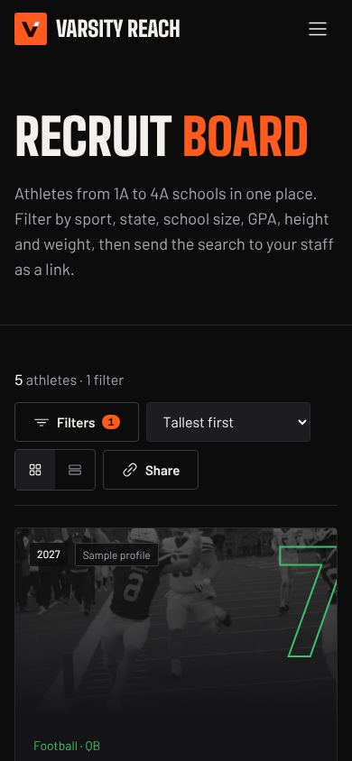 |
| 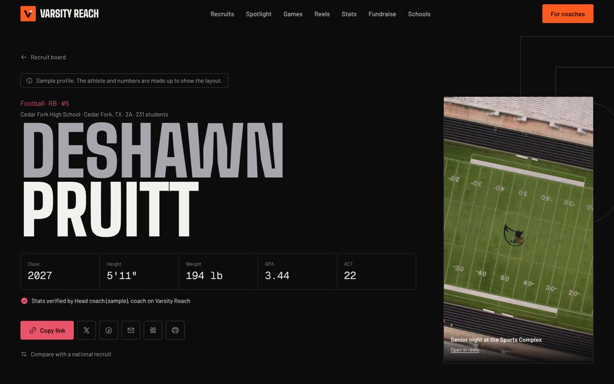 | 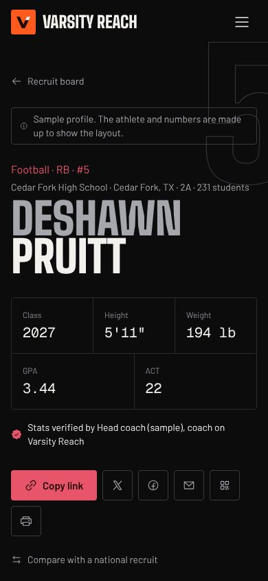 |
| 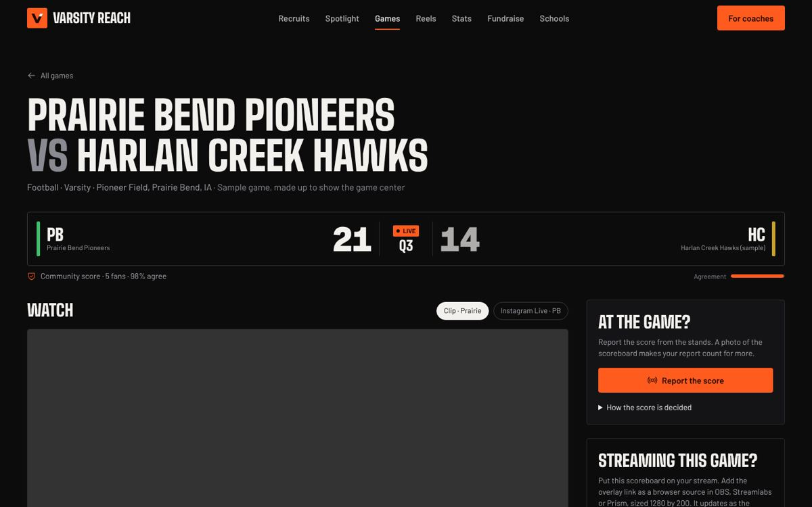 | 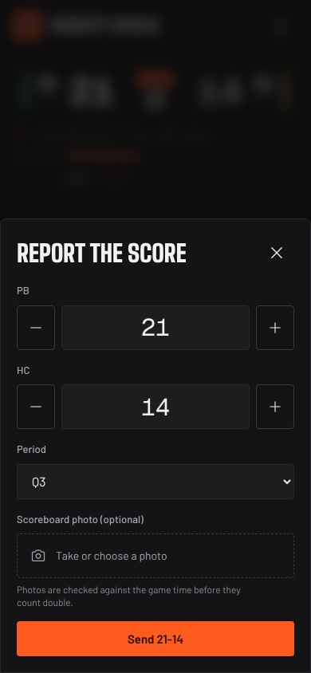 |
| 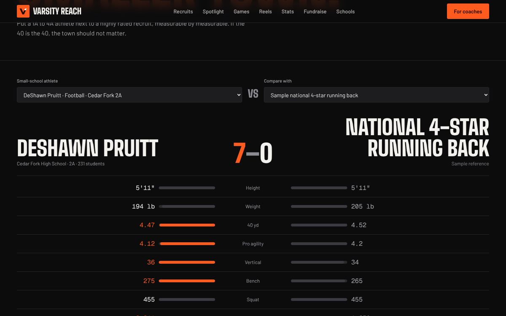 | 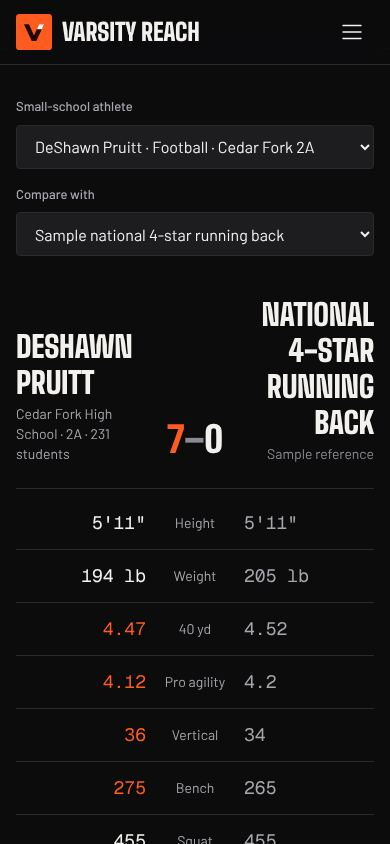 |
| 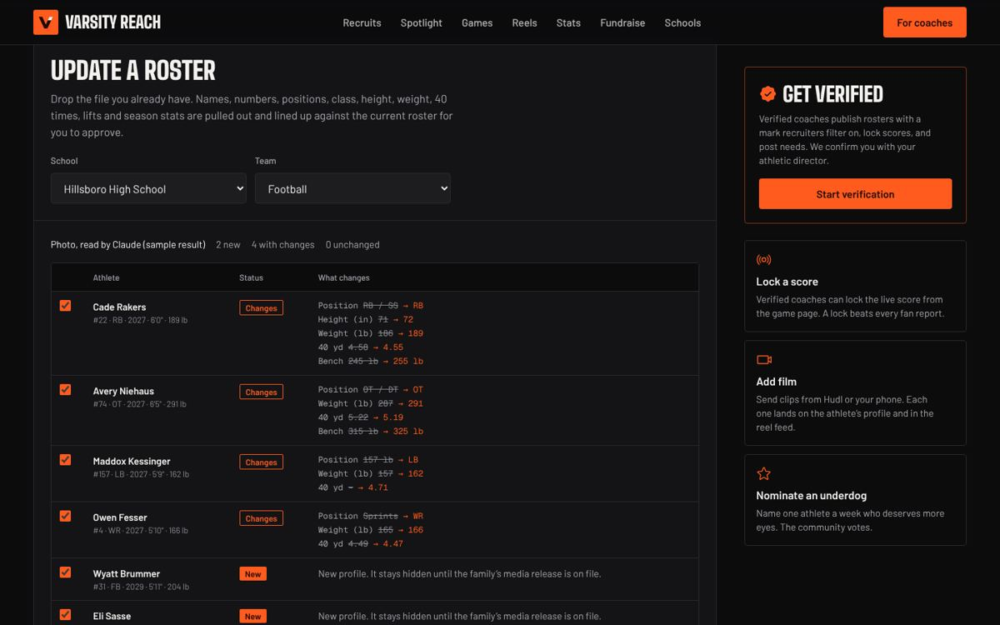 | 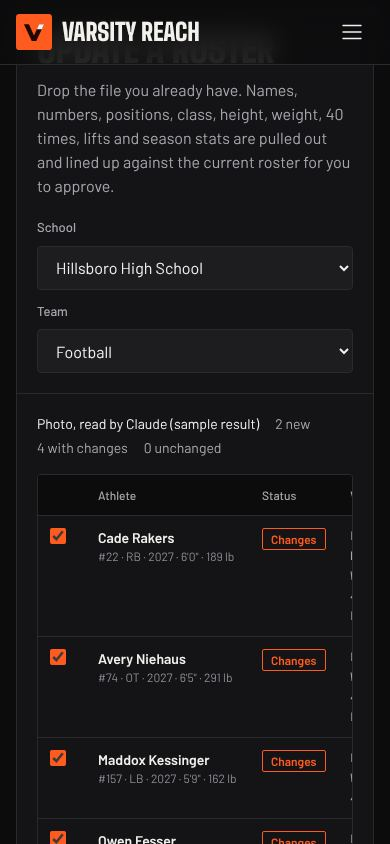 |
| 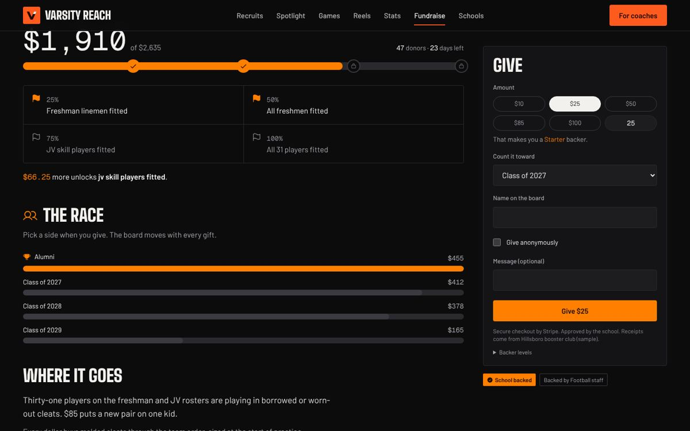 | 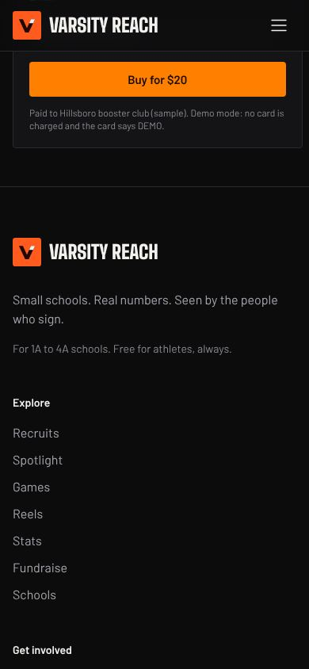 |
| 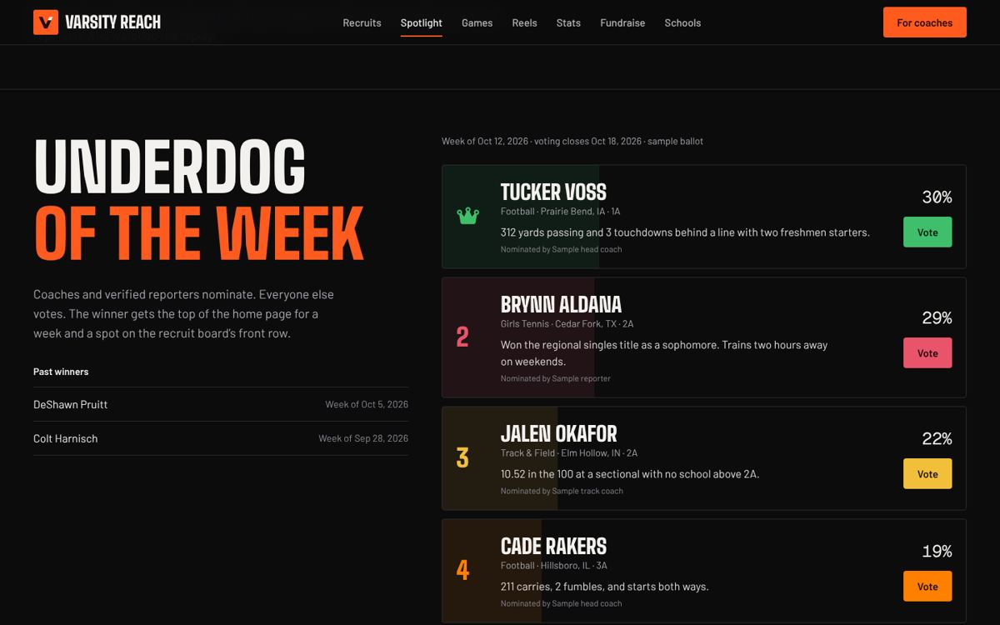 | 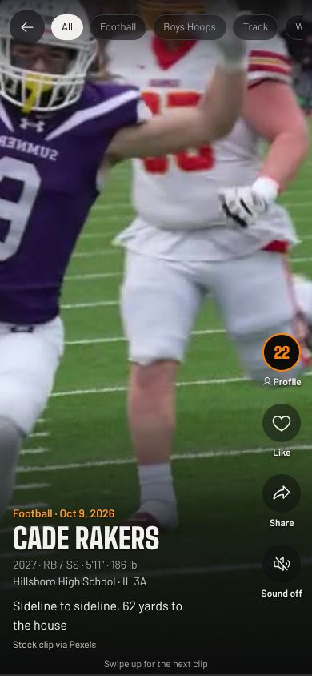 |
